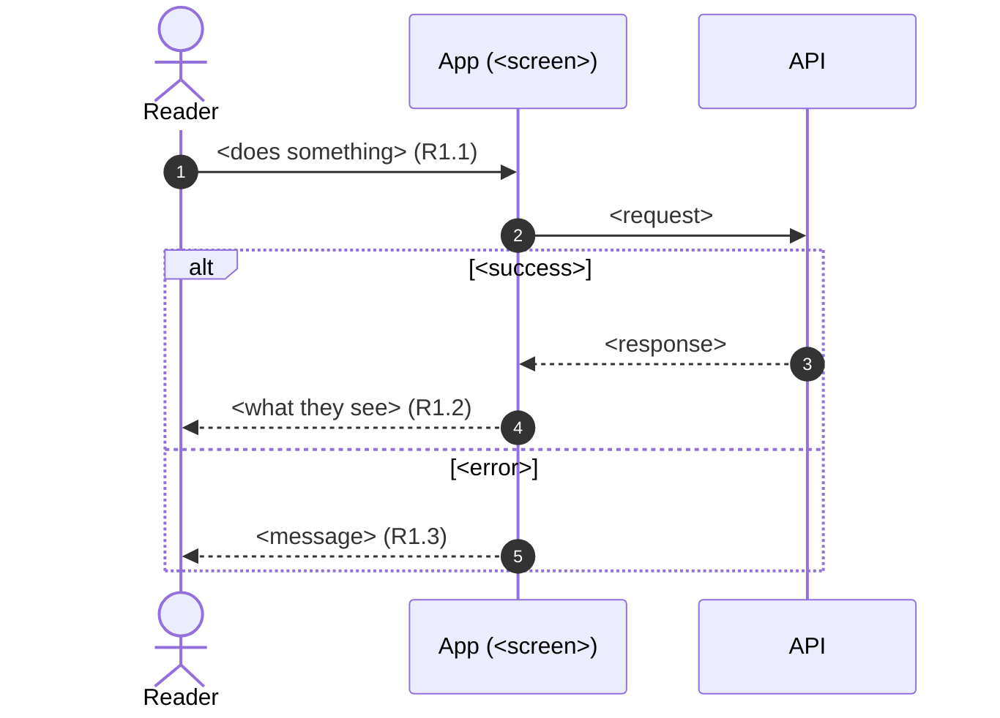

# <Feature>: Requirements

Status: Draft <!-- Draft → Approved -->
Design handoff: docs/handoff/<feature>/ <!-- or "none" -->

## Goal
One paragraph: what problem this solves and for whom.

## Out of scope
- …

## Flows
One Mermaid sequence diagram per main flow, so the feature can be understood
at a glance before reading the rules. Show the happy path plus its important
branches (`alt` / `opt`). Participants are the people and parts involved
(reader, app screen, API, database, push), and messages are in plain words
with the requirement IDs they cover, like (R2.1). The requirements below stay
the source of truth; keep the diagrams in step when they change.

## Requirements

### R1. <Name>
**User story:** As a <reader>, I want <x> so that <y>.

**Acceptance criteria**
1. WHEN <condition> THE <screen/component> SHALL <behavior>.
2. IF <error case> THEN THE <x> SHALL <behavior>.

## Open questions
- [ ] …
