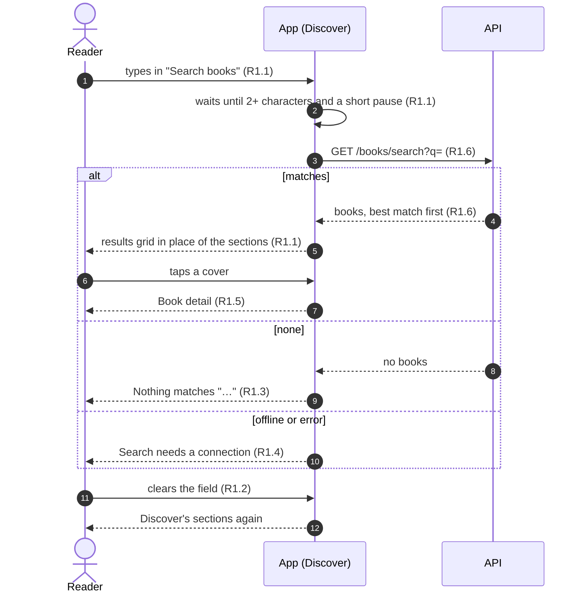
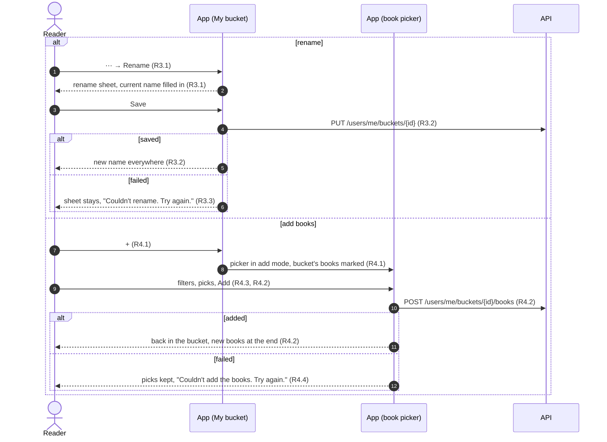
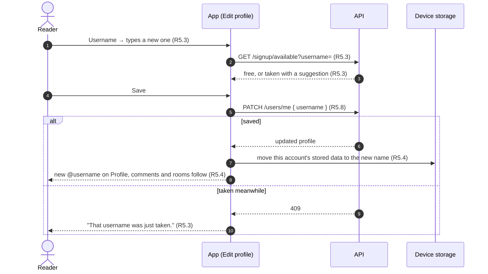
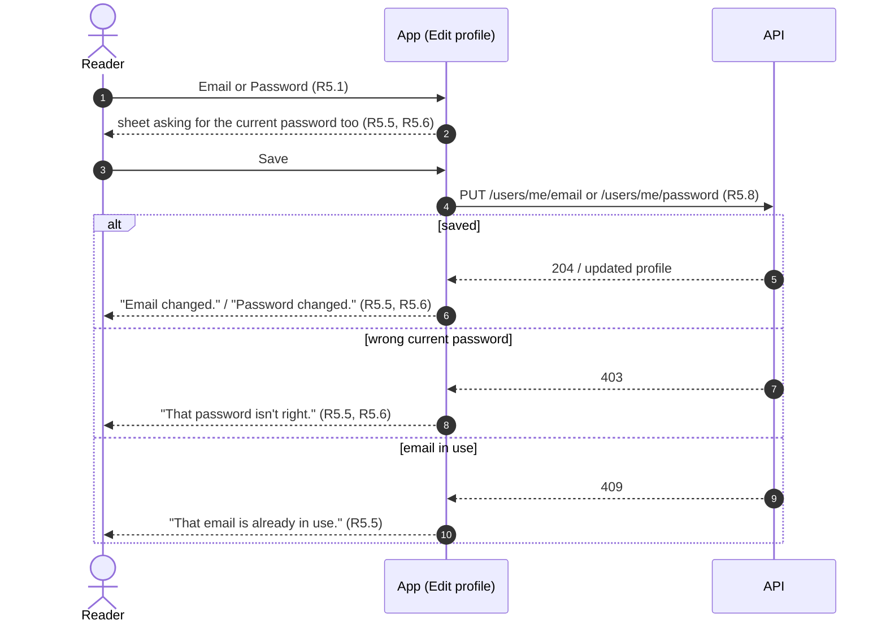

# Coming soon: Requirements

Status: Approved <!-- Draft → Approved -->
Design handoff: docs/handoff/ReadPanda Design Review.dc.html, for the entry points only: 8a's "Search books" field, 8b's "Finished · N books" link, 9a's "⋯ renames or deletes" and "+", 7a's "Edit profile" pill. There's no mockup of the search results, the rename sheet, the add-books picker in a bucket, or the Edit profile screen; they're built from existing screens and sheets.

## Goal
Seven buttons in the app show a "coming soon" toast instead of doing anything:
Discover's search, the Finished link on My Books and Reading, renaming a
bucket, adding books from inside a bucket, and Edit profile. Before the app
reaches TestFlight testers and App Review, each does what it says.

## Out of scope
- Editing or uploading a profile photo. The photo stays as it is today: the
  one Google gives at sign-in, or one picked on Profile, saved on this device
  only.
- Showing the display name anywhere but the reader's own Profile (comments,
  rooms and members keep showing usernames).
- Confirming a new email by link, and "Forgot password": the server can't
  send email yet.
- Searching by genre, topic or the text of a book.
- Android, which has no reader yet and isn't in 1.0.

## Flows

Searching on Discover:

Changing a bucket from inside it:

Changing the username:

Changing email or password (email accounts):

## Requirements

### R1. Search on Discover
**User story:** As a reader, I want to find a book by its title or author, so
that I can start it without scrolling.

**Acceptance criteria**
1. WHEN the reader types 2 or more characters in Discover's "Search books"
   field and pauses (300ms) THE Discover screen SHALL show the matching books
   as a cover grid in place of its sections.
2. WHEN the field is cleared or cancelled THE Discover screen SHALL show its
   sections again, as they were.
3. IF nothing matches THEN THE screen SHALL say `Nothing matches "<query>".`
4. IF the search can't reach the server THEN THE screen SHALL say "Search
   needs a connection." and search again when the reader edits the query.
5. WHEN the reader taps a result THE app SHALL open Book detail (8c).
6. `GET /books/search?q=` SHALL match `q` (2 or more characters, after
   trimming) case-insensitively against title and author name, over the same
   books `/books/all` returns, and return up to 50, ordered: title starts with
   `q`, then title contains `q`, then author contains `q`, then by title. It
   SHALL return `400` for a shorter `q`.
7. THE field's placeholder SHALL read "Title or author".

### R2. Finished books
**User story:** As a reader, I want to see every book I've finished.

**Acceptance criteria**
1. WHEN the reader taps "Finished · N books" on My Books or Reading THE app
   SHALL open a cover grid of every finished book (started, at 100%), the
   most recently read first.
2. Each cover SHALL show the finished check and open Book detail when tapped.
3. THE grid SHALL work offline: it's the books on this device's shelf.

### R3. Rename a bucket
**User story:** As a reader, I want to rename a bucket.

**Acceptance criteria**
1. WHEN the reader chooses Rename (My bucket's ⋯, or the bucket grid's) THE
   app SHALL open a rename sheet with the current name filled in, and Save
   SHALL stay disabled until the name is 1–40 characters (trimmed) and
   different.
2. WHEN the rename saves THE new name SHALL show everywhere the bucket does.
3. IF the rename fails THEN THE sheet SHALL stay open with "Couldn't rename.
   Try again." and the old name SHALL stay.
4. THE same sheet SHALL be used on iOS and Android (it replaces the iOS
   system prompt).

### R4. Add books from inside a bucket
**User story:** As a reader, I want to add books to a bucket I already have.

**Acceptance criteria**
1. WHEN the reader taps + in My bucket THE app SHALL open the book picker
   (New bucket's, with My library, Discover and search) titled "Add to
   <bucket>", with the books already in the bucket marked and not pickable.
2. WHEN the reader taps Add THE picked books SHALL be added to the bucket,
   after its existing books, and the reader SHALL return to the bucket.
3. THE picker's search SHALL filter the books it shows, as it does in New
   bucket.
4. IF adding fails THEN THE picks SHALL be kept and THE picker SHALL say
   "Couldn't add the books. Try again."

### R5. Edit profile
**User story:** As a reader, I want to change my name, username, email and
password.

**Acceptance criteria**
1. WHEN the reader taps Edit profile THE app SHALL open an Edit profile
   screen with rows for Display name and Username, and, for accounts that
   sign in with email and password only, Email and Password. Each row opens
   its own sheet.
2. Display name SHALL be 0–40 characters after trimming. Saved, it SHALL show
   on the reader's Profile above `@username`; empty, the Profile SHALL show
   the username as now.
3. Username SHALL follow the sign-up rules (3–20 letters, numbers, `.` or `_`,
   stored lowercase). Its sheet SHALL check availability as the reader types
   and offer the suggestion when taken. IF it's taken by the time it's saved
   THEN THE sheet SHALL say "That username was just taken."
4. WHEN the username changes THE reader's comments, rooms and Profile SHALL
   show the new one, and THE app SHALL move everything this account stored on
   the device to the new username, so nothing is lost.
5. Email SHALL need the current password and a valid address. IF the
   password is wrong THEN "That password isn't right."; IF another account
   uses the address THEN "That email is already in use."
6. Password SHALL need the current password and a new one of 8 or more
   characters, entered twice. IF the current one is wrong THEN "That password
   isn't right."
7. FOR an account that signs in with Apple or Google THE screen SHALL NOT
   show Email or Password, and SHALL show "Signed in with Apple" or "Signed
   in with Google" instead.
8. The server SHALL add `GET /users/me` (read on opening Edit profile),
   `PATCH /users/me` (`display_name`, `username`),
   `PUT /users/me/email` (`email`, `current_password`) and
   `PUT /users/me/password` (`current_password`, `new_password`); and sign-up,
   login, Google, Apple and refresh responses SHALL include `user_id`,
   `display_name` and `login_type`.

### R6. ReadPanda+ follows the account
**User story:** As a subscriber, I want my subscription to survive a username
change.

**Acceptance criteria**
1. THE app SHALL identify the reader to RevenueCat by their account id
   (`user_id`), not their username.
2. WHEN a stored session from before this change has no `user_id` THE app
   SHALL get it from the server at launch (or the next token refresh), and
   SHALL NOT identify the reader
   to RevenueCat by username in the meantime.

## Open questions
- [x] Rename: the in-app sheet on iOS too (R3.4).
- [x] Search: 300ms pause, 2 characters, 50 results.
- [x] The picker's search stays a filter, in New bucket and in add mode (R4.3).
- [x] The profile photo stays as it is (Google's, or picked on the device); no R7.
