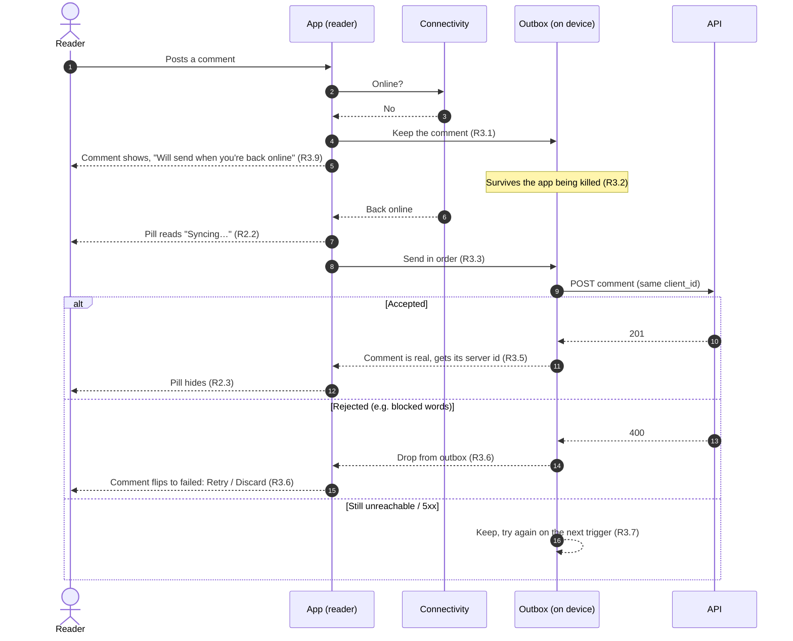
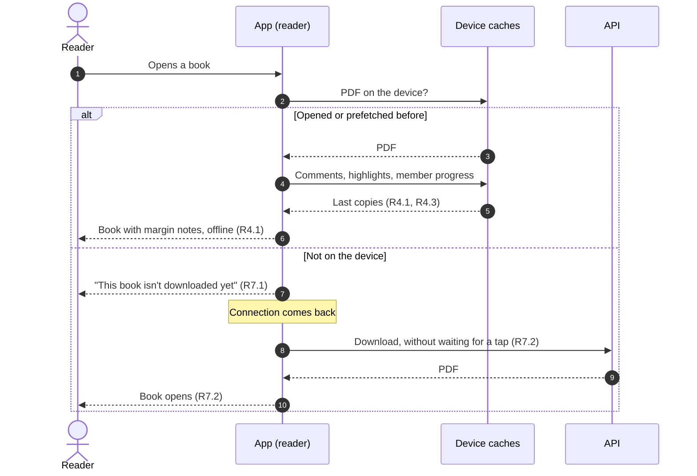
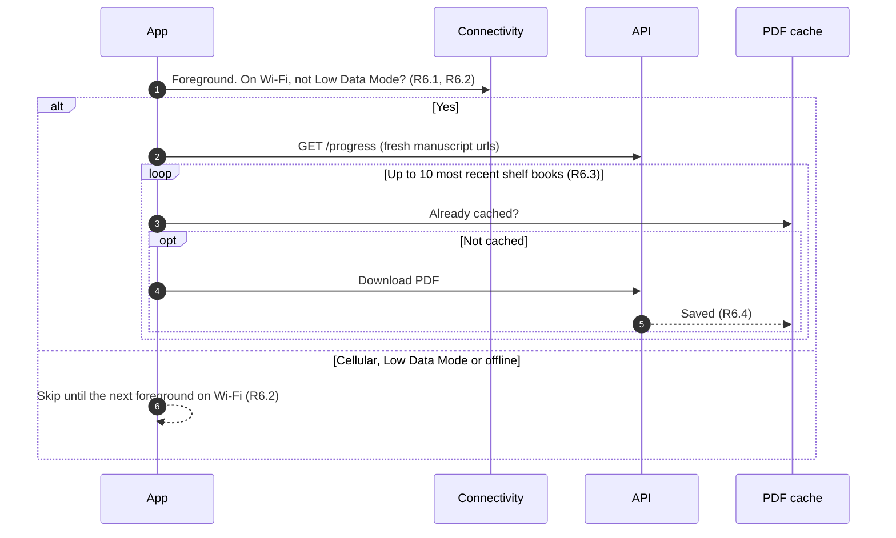
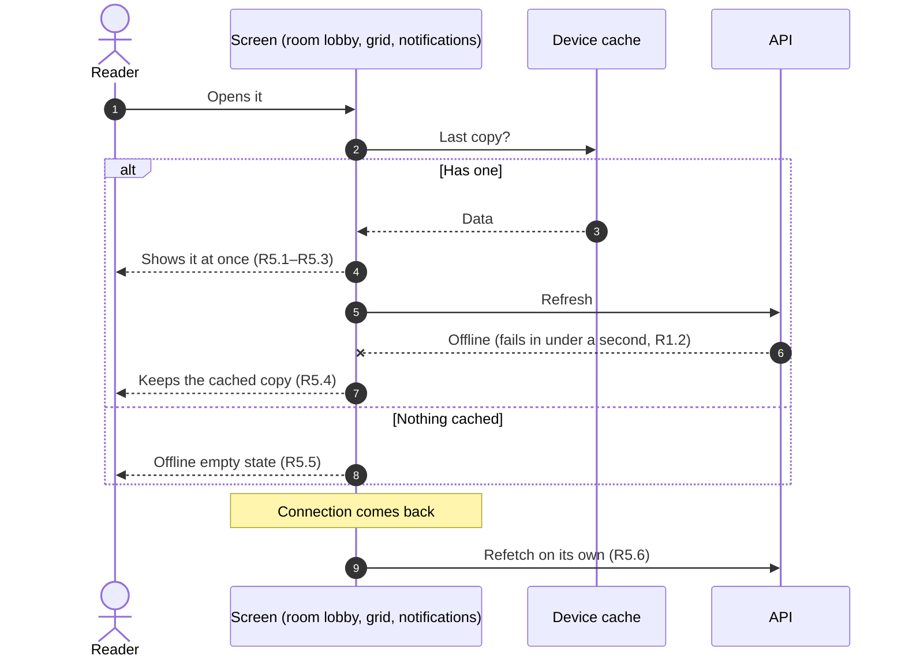
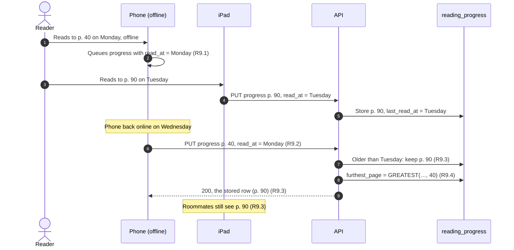
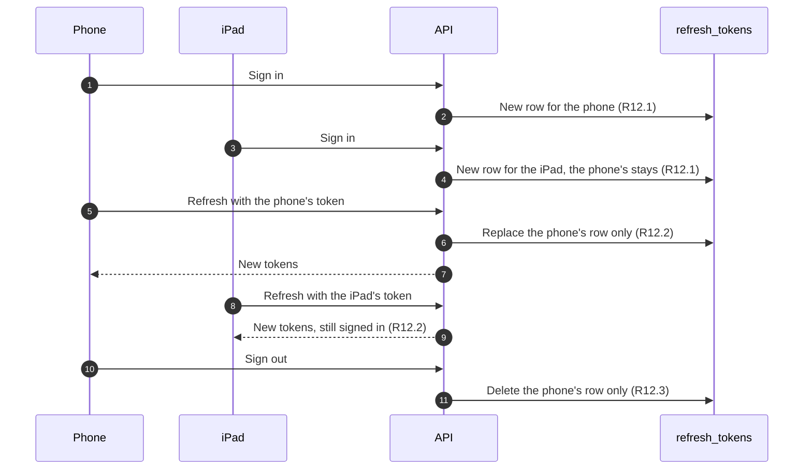

# Offline first: Requirements

Status: Approved <!-- Draft → Approved -->
Design handoff: none. The Offline pill follows docs/DESIGN.md's "Glass &
Gradient" rule for floating elements. Empty and error states reuse the
`cloud-offline-outline` states that BookGridScreen, DiscoverScreen and
OpenRoomsScreen already draw. The reader's offline state reuses the native
status view in `ios/RNPdfViewer.swift`. The cover and curated header fixes
(R10, R11) follow the screens as they are, with the top bar in the
`surfaceContainerGlass` token.
Spans two places:
- readpanda-mobile (everything but R9.3–R9.5)
- readpanda `packages/api-go`: `PUT /progress/{bookId}` learns to ignore an
  older write (R9), and each device keeps its own sign-in (R12). Every other write is already idempotent on the API:
  comments and highlights on `client_id`, likes, unlikes and notification
  reads by definition, and a delete that 404s is already gone.

## Goal
ReadPanda is for reading, and people read where the signal is bad: on a
plane, on the underground, in bed with the phone on aeroplane mode. Today a
book you've opened before still opens, and your page is kept, but almost
everything around it fails:
- margin notes vanish
- a highlight made offline is rolled back with an error toast
- a comment written offline is lost if the app is killed
- every screen waits about 7 seconds before showing an error
- a book you haven't opened yet shows a raw iOS file error
- covers that can't load leave empty tiles

This makes the app offline first. What you've seen before shows straight
from the device, what you do offline is kept and sent when you're back, the
books you're reading are downloaded on Wi-Fi before you need them, and the
app says plainly when it's offline instead of failing slowly. A phone that
syncs a day late can't pull another device's newer page back.

It also fixes two layout bugs from the same device pass. Placeholder cover
titles are clipped at the top edge. On a curated bucket, the page scrolls
under the status bar and the floating back button.

## Out of scope
- Signing in, signing up, and anything else in the Auth stack offline
- Creating, joining, leaving or editing rooms offline; saving or editing
  buckets; purchases; profile edits; reporting and blocking. These stay
  online-only and fail fast with a clear message (R1.5).
- An explicit Download button or a storage screen. Prefetch is automatic
  (R6).
- Offline search, Discover genres not opened before, and books never opened
  or prefetched
- Merging two devices' offline edits beyond R9: highlights and comments
  from both devices are simply all kept, and a phone doesn't move its own
  open book to a page another device read
- An uncached book whose stored `manuscript_url` has expired. That's an
  online problem and isn't changed here.
- Other headers. R11 covers CuratedBucketScreen only.
- Android-specific behaviour. 1.0.0 ships on iOS only; the shared JS must
  not break Android.

## Flows
The picture first; the numbered requirements below are the exact rules.
Labels like (R3.2) point to them.

### Writing a comment offline
Highlights, likes, unlikes, comment reads, notification reads, deletes and
reading progress take the same path through the outbox (R3).

### Opening the reader offline

### Shelf prefetch

### A screen offline

### Progress synced a day late

### Two devices, one account (R12)

## Requirements

### R1. Knowing when we're offline
**User story:** As a reader, I want the app to know it has no connection so
it doesn't make me wait for requests that can't work.

**Acceptance criteria**
1. WHEN the device loses or regains internet access THE app SHALL update its
   online state within 2 seconds.
2. WHILE the app is offline, THE API client SHALL reject a request at once,
   with no retries, with an error marked as offline.
3. THE API client SHALL abandon any request that hasn't answered within 15
   seconds and treat it as a network error, without retrying it: it has
   already waited longer than a retry would.
4. WHILE the app is online, THE API client SHALL keep retrying network errors
   that fail fast (not timeouts) and 5xx responses with its current backoff.
5. WHEN a write outside the outbox (R3.1) is attempted offline, such as
   creating or joining a room, saving a bucket, a purchase, a profile edit, a
   report or a block, THE app SHALL fail within 1 second and show the toast
   "You're offline. Try again when you're connected." instead of the
   action's generic error.
6. IF two requests in a row get no answer (a timeout or a failed connection)
   while the network looks connected (a dead Wi-Fi, a captive portal, 100%
   packet loss) THEN THE app SHALL treat itself as offline until a request
   gets an answer.

### R2. The Offline pill
**User story:** As a reader, I want a quiet sign that I'm offline so I know
why things are stale and that my changes are kept.

**Acceptance criteria**
1. WHILE the app is offline, THE app SHALL show a small "Offline" pill near
   the bottom, just clear of the tab bar, on every signed-in screen, the
   reader included. It doesn't take taps and doesn't move the content under
   it, and toasts shown meanwhile sit above it.
2. WHEN the connection returns AND the outbox has items THE pill SHALL read
   "Syncing…" until the outbox is empty or its next item fails.
3. WHEN the connection returns AND the outbox is empty, or it empties, THE
   pill SHALL fade out.
4. WHEN the app goes offline or comes back THE app SHALL announce "You're
   offline" or "Back online" to VoiceOver.

### R3. The outbox: what you do offline is kept
**User story:** As a reader, I want what I do offline to stick and reach my
room when I'm back, so reading offline isn't second class.

**Acceptance criteria**
1. WHEN any of these writes can't reach the server (offline, a network error
   or a timeout) THE app SHALL keep it in an on-device outbox and keep
   showing the change as made:
   - reading progress
   - adding or removing a highlight
   - posting a comment or reply
   - liking or unliking a comment
   - marking comments read
   - deleting your own comment
   - marking a notification read
2. THE outbox SHALL survive the app being killed and the phone restarting,
   and SHALL belong to the signed-in account.
3. WHEN the connection returns, the app comes to the foreground, or the
   account is restored at launch THE app SHALL send the outbox's items one at
   a time in the order they were made.
4. THE outbox SHALL collapse writes that cancel or replace each other before
   they're sent:
   - only the latest reading progress per book is kept
   - only the last like or unlike per comment is kept
   - a highlight added and removed before syncing is dropped, both halves
   - a comment posted and deleted before syncing is dropped, both halves
   - comment reads for a book are merged into one item
5. WHEN an item refers to a comment that is itself still in the outbox (a
   reply to it, a like, a delete) THE app SHALL send it only after that
   comment is accepted, using the comment's server id.
6. IF the server rejects an item with a 4xx THEN THE app SHALL remove it from
   the outbox and undo it on screen:
   - a comment flips to failed with the existing Retry and Discard, and the
     blocked-words copy when that's the reason
   - a highlight is removed, with a toast "Couldn't save a highlight you made
     offline"
   - a like, unlike or read is put back
   - a 404 on a delete or a highlight removal counts as done, not rejected
7. IF an item fails with a network error or a 5xx THEN THE app SHALL keep it
   and stop sending until the next trigger in R3.3, so a bad connection
   doesn't burn through the queue.
8. WHEN a reader with unsent outbox items signs out THE app SHALL ask first:
   "{n} changes haven't synced yet. Sign out anyway?", with Sign out and
   Cancel. Signing out anyway drops them.
9. WHILE a comment is waiting in the outbox, THE comment sheet SHALL show
   "Will send when you're back online" under it instead of the spinner.
10. WHEN comments or highlights are reloaded from the server THE app SHALL
    keep the ones still in the outbox on screen.

### R4. The reader offline
**User story:** As a reader, I want a book I've opened before to look the
same offline: my highlights, my room's comments and where everyone is.

**Acceptance criteria**
1. WHEN a book is opened THE reader SHALL show its last-loaded comments and
   highlights from the device at once, online or not, then refresh them when
   online.
2. THE app SHALL keep comments and highlights for the 30 books opened most
   recently, per account.
3. WHEN the Reading shelf or Home shows a book read with a room THE pace
   track SHALL show the last-loaded member progress, offline too.
4. WHEN queued reading progress is accepted THE app SHALL reload that book's
   comments, so comments unlocked by pages read offline appear.

### R5. Screens show what they last loaded
**User story:** As a reader, I want the screens I've visited to show what
they showed last time instead of an error.

**Acceptance criteria**
1. WHEN a room lobby is opened THE screen SHALL show the room's last-loaded
   details, members and where everyone is, offline too.
2. WHEN a curated bucket, one of the reader's own buckets, or a "See all"
   grid is opened THE screen SHALL show its last-loaded books, offline too.
3. WHEN the notifications list is opened THE list SHALL show the
   last-loaded notifications and unread count, offline too.
4. WHILE a screen is showing cached data, IF a refresh fails THEN THE screen
   SHALL keep the cached data and SHALL NOT show an error state.
5. IF a screen has nothing cached AND the app is offline THEN THE screen
   SHALL show its offline state, "You're offline. This will load when you're
   back online.", instead of the generic error.
6. WHEN the connection returns while a screen in R5.1–R5.3 is focused THE
   screen SHALL refetch without a pull to refresh.

### R6. Books on the shelf are downloaded on Wi-Fi
**User story:** As a reader, I want the books I'm reading on my phone before
I lose signal, without having to think about it.

**Acceptance criteria**
1. WHEN the app comes to the foreground on Wi-Fi THE app SHALL download the
   PDFs of the Reading shelf's books that aren't on the device yet, in the
   background.
2. WHILE on cellular, in Low Data Mode, or offline, THE app SHALL NOT
   prefetch.
3. THE app SHALL prefetch at most the 10 most recently read shelf books, one
   at a time, and stop if Wi-Fi drops.
4. WHEN a prefetched book is opened offline THE reader SHALL open it from the
   device like any book read before.
5. WHEN the app prefetches on Wi-Fi THE app SHALL also load the page of
   every curated bucket and every one of the reader's own buckets, so each
   opens offline with its details and books, opened before or not.
6. THE app SHALL also download the cover images of those buckets and their
   books, at most 200, and stop if Wi-Fi drops.

### R7. The reader's offline state
**User story:** As a reader, I want a plain explanation when a book can't
open offline, and for it to open by itself once I'm back.

**Acceptance criteria**
1. WHEN a book that isn't on the device can't download because there's no
   connection THE reader SHALL show the offline state: a cloud-offline icon,
   "This book isn't downloaded yet" and "Connect to the internet to open it.
   After that it stays on this phone.", with Retry. It SHALL NOT show the
   system error or the file name.
2. WHEN the connection returns while the offline state is showing THE reader
   SHALL start the download without waiting for Retry.
3. IF the download fails for any other reason THEN THE reader SHALL show
   "Couldn't open this book" with Retry, without the system error text.

### R8. Covers never go blank
**User story:** As a reader, I want every cover to show something, even when
its image can't load.

**Acceptance criteria**
1. IF a cover image fails to load THEN THE cover SHALL show the duotone
   placeholder with the book's title in its place.
2. WHILE the app is offline, THE cover SHALL use a cached image when the
   device has one, whatever its age.

### R9. A late sync can't pull progress backwards
**User story:** As a reader with a phone and an iPad, I want an old page
from a phone that was offline not to replace where I've read to since.

**Acceptance criteria**
1. WHEN reading progress is saved THE app SHALL record when it was read, and
   the outbox SHALL keep that time through collapsing (the latest save's
   time wins).
2. WHEN progress is sent THE app SHALL include that time as `read_at`.
3. WHEN `PUT /progress/{bookId}` receives a `read_at` older than the stored
   `last_read_at` THE API SHALL keep the stored `current_page`,
   `total_pages` and `last_read_at` and return the stored row with `200`.
4. THE API SHALL still raise `furthest_page` to `GREATEST(stored,
   current_page)` for an older write, so comments unlocked by pages really
   read offline unlock.
5. WHEN `read_at` is missing, unparseable, or later than the server's clock
   THE API SHALL use the server's clock, so older app versions and a phone
   with its clock set ahead behave as today.

### R10. Placeholder cover titles fit
**User story:** As a reader, I want a book without a cover image to show
its whole title, not a line cut off at the top.

**Acceptance criteria**
1. WHEN a cover shows the duotone placeholder THE title SHALL sit at the
   bottom of the cover, inside its padding, with no part of it clipped by
   the top or bottom edge.
2. IF the title is longer than fits in 3 lines THEN THE title SHALL end in
   an ellipsis.
3. WHILE iOS Larger Text is on, THE title SHALL still fit within the cover,
   by capping how far it scales.

### R11. The curated bucket's top bar
**User story:** As a reader, I want the status bar and back button to stay
clear when I scroll a curated bucket, so the title doesn't run under them.

**Acceptance criteria**
1. WHEN the curated bucket scrolls past the hero THE screen SHALL fade in a
   top bar behind the status bar and the back button, in
   `surfaceContainerGlass`, with the bucket's name.
2. WHEN it scrolls back to the hero THE top bar SHALL fade out, leaving the
   hero full bleed as today.
3. WHILE the page is scrolled, THE back button SHALL never sit over text or
   covers without the top bar behind it.
4. THE top bar SHALL work the same on iPad's sideways hero.

### R12. Each device stays signed in
**User story:** As a reader with a phone and an iPad, I want signing in or
reading on one not to sign me out of the other, so I can read offline on one
while the other is online (R9).

Found while testing: the API kept one refresh token per account, so any
sign-in or token refresh on one device signed every other device out at its
next refresh.

**Acceptance criteria**
1. WHEN a reader signs in on a device THE API SHALL keep a refresh token for
   that sign-in alongside any the reader has on other devices.
2. WHEN a refresh token is used THE API SHALL replace that token only; the
   reader's other devices SHALL stay signed in.
3. WHEN a reader signs out THE API SHALL end only that device's sign-in.
4. WHEN an account is suspended THE API SHALL still end every sign-in, as
   today.
5. WHEN a reader signs in THE API SHALL delete that reader's expired refresh
   tokens, so the table doesn't grow.

## Open questions
None. Decided during the spec review on 2026-10-27:
- Progress from two devices: older writes are ignored by the API (R9)
- Prefetch cap: 10 books (R6.3)
- The cover title and curated header fixes are part of this spec (R10, R11)
- Per-device sign-in is part of this spec (R12), found in testing on
  2026-10-28: R9's two-device check can't run without it
