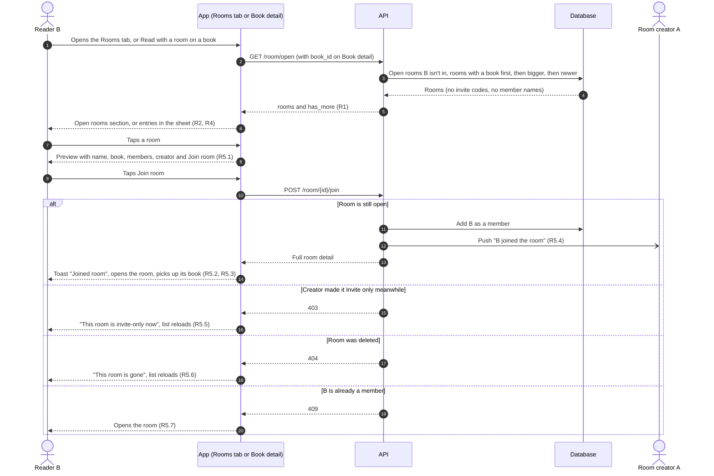
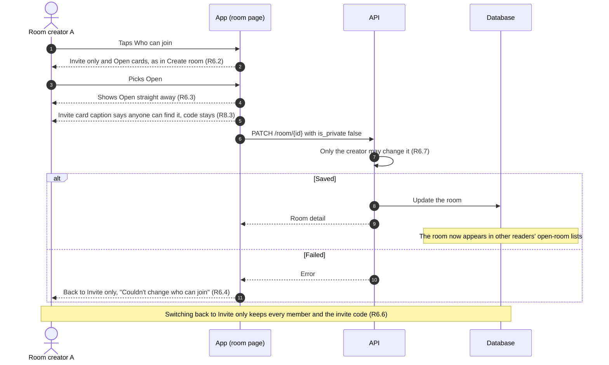
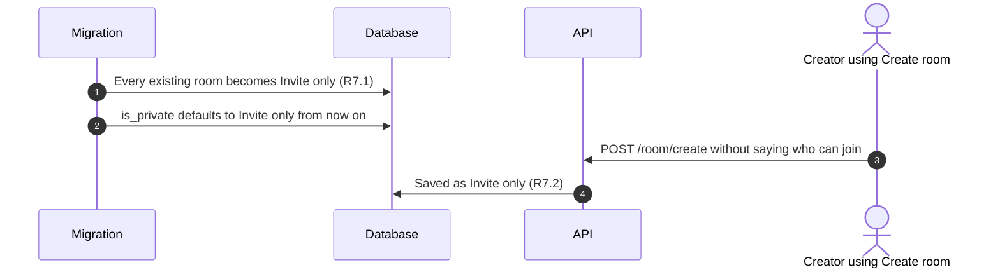

# Open rooms: Requirements

Status: Approved <!-- Draft → Approved -->
Design handoff: none for finding open rooms. Create room's privacy cards
(2b / 15j) are the existing reference; the new parts follow the Rooms tab
(1c / 15i), Book detail's "Read with a room" (8c) and docs/DESIGN.md.
Spans both repos: the API changes are in readpanda (`packages/api-go`).

## Goal
Create room offers **Open: "Anyone on ReadPanda can find it."** Nothing lets
anyone find it. The choice only saves `is_private` on the room. That's a
promise the app doesn't keep, and App Review will find it.

This makes Open real:
- Open rooms show on the Rooms tab and on the Book detail of the book they
  read.
- Anyone can look at one and join with one tap, no code needed.
- A creator can switch their room between Open and Invite only.

Every room that exists today becomes Invite only, so no room turns public
without its creator choosing it.

## Out of scope
- Searching open rooms by name, or filtering by genre
- Asking to join, or the creator approving joins
- Reading a room's comments before joining. Comments stay members-only.
- A member cap. Free-plan limits are off at launch (specs/plus-off-switch).
- Reporting or blocking in open rooms. That's the report/block spec, which
  must ship in the same release, because open rooms put strangers together.
- Open rooms on Discover. The design rules keep rooms off Discover.
- Telling a room's members that it has become open

## Flows
The picture first; the numbered requirements below are the exact rules.
Labels like (R5.2) point to them.

### Find an open room and join it

### The creator switches who can join

### Existing rooms when this ships

## Requirements

### R1. The open-rooms list (API)
**User story:** As a reader looking for people to read with, I want to see
rooms I could join.

**Acceptance criteria**
1. THE API SHALL list rooms whose creator chose Open, and only those.
2. THE list SHALL leave out rooms the reader is already in.
3. WHEN a book is given THE list SHALL hold only open rooms currently
   reading that book.
4. EACH room in the list SHALL carry:
   - its name and description
   - the book it's reading (title and cover), if any
   - how many members it has
   - its creator's username
5. THE list SHALL NOT include a room's invite code, its members' names, or
   anything else only members see.
6. THE list SHALL put rooms reading a book first, then rooms with more
   members, then newer rooms.
7. THE list SHALL come in pages, and SHALL say whether there are more.

### R2. Rooms tab
**User story:** As a reader on the Rooms tab, I want to see open rooms below
my own, so that I can find one to join.

**Acceptance criteria**
1. THE Rooms tab SHALL show an "Open rooms" section after "Your rooms",
   with up to 2 rooms.
2. WHEN there are more than 2 THE section SHALL have a "See all" that opens
   the full list.
3. WHEN there are no open rooms to show, or they can't be loaded, THE
   section SHALL be hidden, and the rest of the tab SHALL work as today.
4. EACH open room SHALL show its book cover, name, what it's reading
   ("No book yet" if nothing), and its member count.
5. WHEN the reader pulls to refresh or comes back to the tab THE section
   SHALL reload with the rest of the tab.
6. WHEN the window is iPad-sized THE open rooms SHALL use the same
   2-column grid as the reader's own rooms.

### R3. See all open rooms
**User story:** As a reader, I want to browse every open room.

**Acceptance criteria**
1. THE "Open rooms" screen SHALL list every open room the reader isn't in,
   in the order of R1.6, with the same rows as R2.4.
2. WHEN the reader scrolls to the end THE screen SHALL load the next page.
3. THE screen SHALL support pull to refresh.
4. WHEN the list is empty THE screen SHALL say "No open rooms right now"
   and offer "Start a room".
5. THE screen SHALL have a back button to the Rooms tab.

### R4. Book detail
**User story:** As a reader looking at a book, I want to see open rooms
reading it, so that I can read it with others.

**Acceptance criteria**
1. WHEN the reader opens "Read with a room" THE sheet SHALL list open rooms
   reading this book after the reader's own rooms reading it, and before
   "Start a new room".
2. EACH open room SHALL show its name and "Open room · N members".
3. WHEN there are none THE sheet SHALL look as it does today.
4. THE sheet SHALL show at most 5 open rooms.

### R5. Preview and join
**User story:** As a reader who found an open room, I want to see what it is
before I join, so that I don't join by accident.

**Acceptance criteria**
1. WHEN the reader taps an open room anywhere THE app SHALL show a preview
   with:
   - the room's name and description
   - its book (cover and title), or "No book yet"
   - its member count and creator
   - a "Join room" button
2. WHEN the reader taps "Join room" THE app SHALL make them a member, show
   the toast "Joined <room>", and open the room's page.
3. WHEN they join a room that's reading a book THE app SHALL treat it like
   joining by code: the book is adopted, or attached to the reader's own
   copy if they're already reading it.
4. WHEN someone joins an open room THE room's creator SHALL be notified as
   for a join by code ("<username> joined the room").
5. IF the room became Invite only meanwhile THEN THE app SHALL show "This
   room is invite-only now" and refresh the list.
6. IF the room no longer exists THEN THE app SHALL show "This room is gone"
   and refresh the list.
7. IF the reader is already a member THEN THE app SHALL open the room's
   page instead.
8. WHILE the join is in flight THE button SHALL show progress and SHALL NOT
   accept a second tap.
9. THE API SHALL let a reader join without a code only when the room is
   Open.

### R6. Who can join
**User story:** As a room's creator, I want to switch my room between Open
and Invite only, so that I can open it up or close it later.

**Acceptance criteria**
1. THE room's page SHALL show "Who can join" with the current setting
   ("Invite only" or "Open").
2. WHEN the creator taps it THE app SHALL offer the same two choices, with
   the same text, as Create room.
3. WHEN the creator picks one THE app SHALL save it, and SHALL show the
   change straight away.
4. IF saving fails THEN THE app SHALL put the setting back and SHALL show
   "Couldn't change who can join".
5. FOR members who aren't the creator THE setting SHALL show as text, with
   no way to change it.
6. WHEN a room becomes Invite only THE members already in it SHALL stay,
   and its invite code SHALL keep working.
7. THE API SHALL let only the creator change the setting.

### R7. Existing rooms and defaults
**User story:** As someone who made a room before Open meant anything, I
don't want it to become public without me choosing it.

**Acceptance criteria**
1. WHEN this ships THE API SHALL make every existing room Invite only.
2. WHEN a room is created without saying who can join THE API SHALL make
   it Invite only.
3. Create room SHALL still have Invite only selected first.

### R8. Copy that said rooms are invite-only
**Acceptance criteria**
1. THE Rooms tab subtitle SHALL read "Read with your people, or join an
   open room. No set meeting time."
2. THE invite card on the Rooms tab SHALL read "Share a code and read the
   same book on your own schedules." It SHALL NOT say rooms are
   invite-only.
3. THE room page's invite card SHALL keep its code, Share and QR for open
   rooms too. Its caption SHALL read "Anyone with the code can join this
   room" for an Invite only room, and "Anyone on ReadPanda can find this
   room. Share the code to bring friends straight in." for an Open one,
   changing as soon as the setting does.

### R9. Accessibility
**Acceptance criteria**
1. EACH open room row SHALL be announced as a button with its name, its
   book and its member count.
2. THE preview's "Join room" SHALL be announced as a button, and as busy
   while joining.
3. "Who can join" SHALL be announced as a button with its current value
   for the creator, and as text for everyone else.
4. WHEN the text size is larger THE rows and the preview SHALL wrap or
   truncate cleanly, with nothing cut off mid-word.

## Open questions
- [x] Ordering (R1.6) is a simple start. It favours rooms already reading
      and bigger rooms, not rooms that are active. "Most recent comment"
      would be better but needs a heavier query. Resolved 2026-10-21: the
      simple order is fine for launch.
