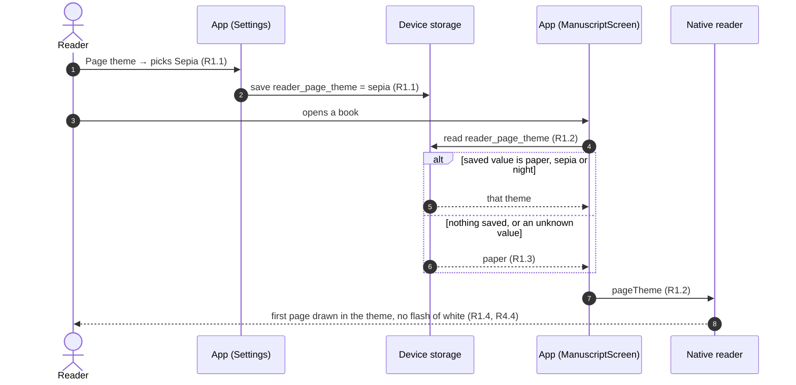
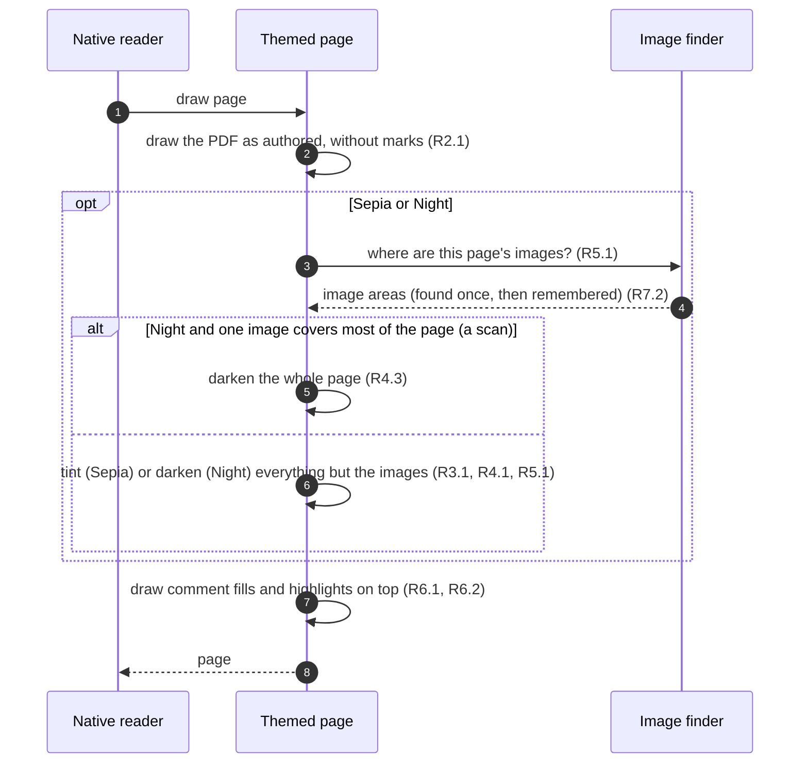

# Page theme: Requirements

Status: Approved <!-- Draft → Approved -->
Design handoff: none (Settings → Page theme is in PROFILE_SETTINGS_7a_7b.md § 7b; there's no mockup of a themed page)

## Goal
Settings → Page theme lets a reader pick Paper, Sepia or Night, and the Help
screen says it changes how books look, but the reader never receives the
choice: every page is drawn on white. This wires the setting into the native
reader so the page is drawn in the chosen theme. Sepia is easier on the eyes in
daylight. Night is for reading in the dark, which is when most ReadPanda reading
happens. Pictures in a manuscript keep their real colours in every theme.

## Out of scope
- Theming the reader's chrome (header, scrubber, comment sheet, status
  screens). It stays the app's dark navy in every theme.
- Changing the theme from inside the reader. It's set in Settings and applies
  to the next book opened.
- Per-book themes, brightness, fonts or text size. A PDF's text can't be
  reflowed or restyled.
- Android, which has no reader yet.

## Flows

Choosing a theme and opening a book:

Drawing one page:

## Requirements

### R1. The reader gets the setting
**User story:** As a reader, I want the page theme I picked in Settings to be the
one I read in, so that the setting does what it says.

**Acceptance criteria**
1. WHEN the reader picks a theme in Settings → Page theme THE app SHALL save it
   on the device for that account, as it does today.
2. WHEN a book opens THE ManuscriptScreen SHALL read the saved theme and pass it
   to the native reader.
3. IF no theme is saved, or the saved value isn't paper, sepia or night, THEN
   THE reader SHALL use Paper.
4. WHEN a book opens THE reader SHALL draw its first page in the theme, with no
   frame drawn in another theme first.

### R2. Paper
**User story:** As a reader, I want Paper to look the way the reader looks today.

**Acceptance criteria**
1. WHILE the theme is Paper THE reader SHALL draw pages exactly as it does
   before this change: white page, the PDF as authored.

### R3. Sepia
**User story:** As a reader, I want a warm page, so that reading in daylight is
easier on my eyes.

**Acceptance criteria**
1. WHILE the theme is Sepia THE reader SHALL draw the page's white as the sepia
   paper colour (`DS.colors.readerSepia`) and keep dark text dark.
2. WHILE the theme is Sepia THE space around the page (the paged card, the gaps
   between pages) SHALL be the sepia paper colour wherever it's white in Paper.

### R4. Night
**User story:** As a reader, I want a black page with white text, so that I can
read in the dark without the page lighting up the room.

**Acceptance criteria**
1. WHILE the theme is Night THE reader SHALL draw the page inverted: white
   becomes black (`DS.colors.readerNight`) and black text becomes white.
2. WHILE the theme is Night THE space around the page SHALL be black wherever
   it's white in Paper.
3. WHILE the theme is Night, IF a single image covers most of a page (a scanned
   page) THEN THE reader SHALL invert that page as a whole, so a scan reads as
   white text on black.
4. WHILE the theme is Night THE reader SHALL NOT show a white page, or white
   space around it, at any point: while the book loads, after a reload, on a
   page turn or on rotation.

### R5. Pictures keep their colours
**User story:** As a reader, I want the pictures in a book to look like
themselves, so that a cover or an illustration isn't spoiled by the theme.

**Acceptance criteria**
1. WHILE the theme is Sepia or Night THE reader SHALL draw each image on the
   page in its own colours, untinted and not inverted, except as R4.3 says.
2. IF an image's position can't be worked out THEN THE reader SHALL draw it
   with the rest of the page (tinted or inverted) rather than fail to draw the
   page.

### R6. Comments and highlights stay readable
**User story:** As a reader, I want comment marks and my highlights to look the
same in every theme, so that I can still tell them apart.

**Acceptance criteria**
1. THE reader SHALL draw comment fills and personal highlights in the same
   hues in every theme (blue for comments, yellow for highlights), not tinted
   or inverted. Comments have no underline: the gutter dot is their cue that
   isn't colour.
2. WHILE the theme is Night THE text inside a comment fill or a personal
   highlight SHALL have at least 4.5:1 contrast against it.
3. THE gutter dots, text selection and the Comment / Highlight menu SHALL work
   the same in every theme.

### R7. No slower
**User story:** As a reader, I want Sepia and Night to scroll and turn pages as
smoothly as Paper.

**Acceptance criteria**
1. WHILE the theme is Sepia or Night THE reader SHALL scroll and turn pages with
   no hitch a reader can see on the oldest supported iPhone, compared with Paper.
2. THE reader SHALL work out a page's image positions at most once per page each
   time a book is opened.

### R8. Chrome stays as it is
**User story:** As a reader, I want the reader's controls to look the same
whatever page theme I use.

**Acceptance criteria**
1. THE header, scrubber, comment sheet, offline pill and status screens SHALL
   look the same in every theme.

## Open questions
- [x] Sepia colour: `#f4ecd8`, a common sepia paper (no mockup exists).
- [x] "Covers most of the page" for R4.3: 70% of the page's area.
- [x] ~~Night comment underline contrast~~: moot, comments no longer have an underline.
