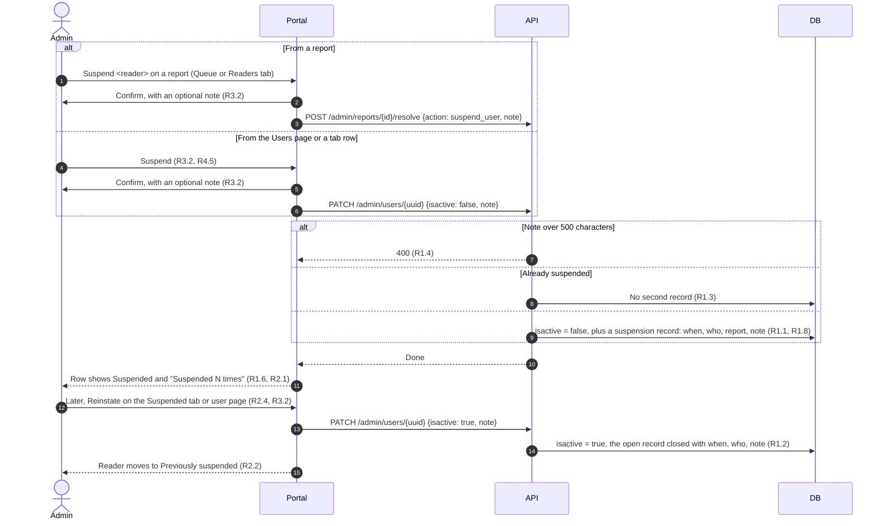
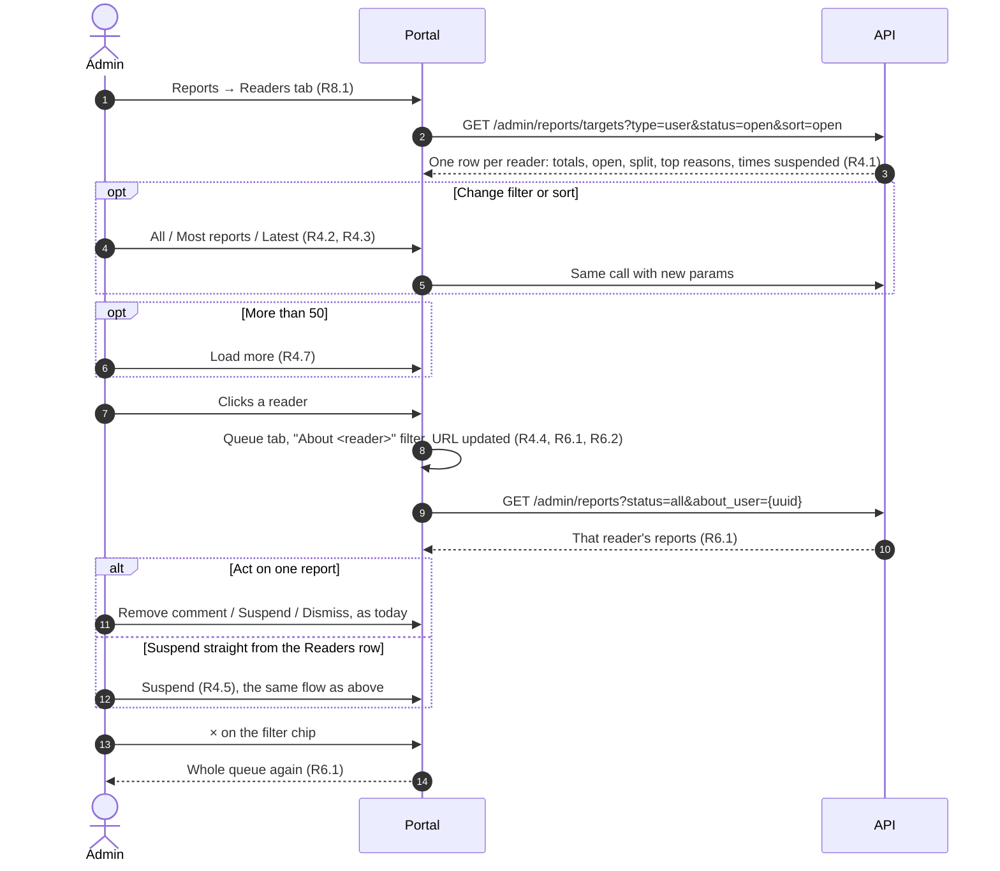
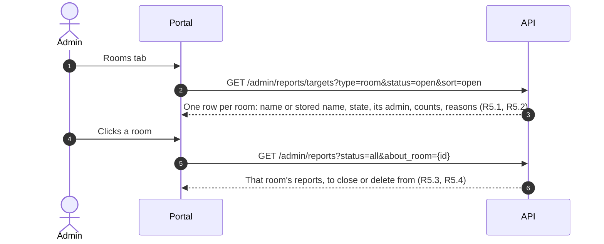
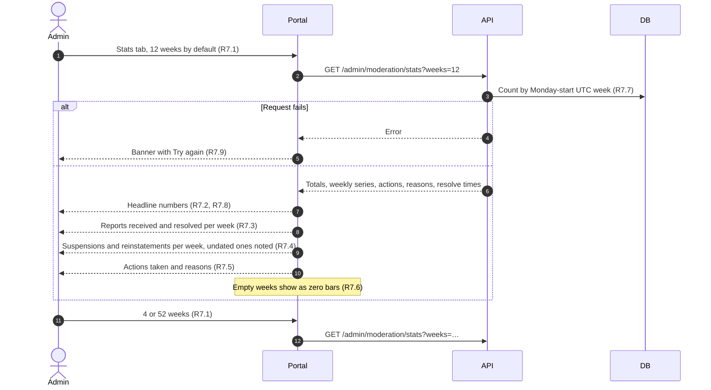
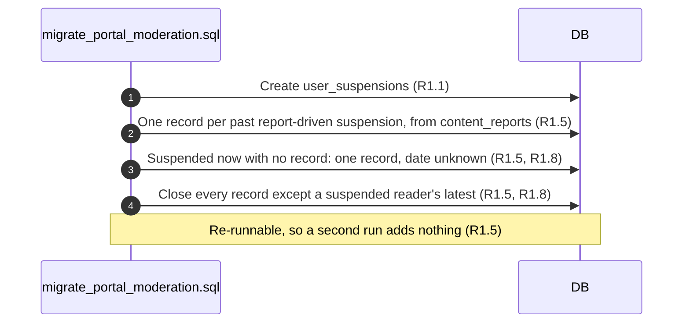

# Portal moderation: Requirements

Status: Draft <!-- Draft → Approved -->
Design handoff: none. The new tabs reuse the portal's existing parts (the
Reports table, `Chip`, `Tag`, `Card`, `Modal`, `Banner`, `EmptyState` in
`packages/portal/src/components/ui.jsx`) and follow docs/DESIGN.md.
Spans two places, both in the readpanda repo:
- `packages/api-go` (the API and a migration)
- `packages/portal` (the admin screens)

Builds on specs/report-block (R9, R10), which must already be deployed.
Writer and platform analytics are a separate spec, portal-analytics.

## Goal
Admins can act on one report at a time, but they can't see a pattern. Today
suspension is only `users.isactive`: nothing records when someone was
suspended, by whom, or why, so we can't tell a first offence from a fifth.
Reports are listed one by one, so a reader with twelve reports looks the same
as twelve readers with one each. And nobody can tell how quickly reports get
handled. Apple expects a "timely response" to reports (Guideline 1.2).

This adds:
- a suspension history, with a count per reader
- a Suspended tab: who is suspended now, and who has been before
- Readers and Rooms tabs that group reports by who or what they're about
- a Stats tab: report volume, time to resolve, actions taken, suspensions over time

## Out of scope
- Writer analytics (a writer's own books) and platform analytics (signups,
  active readers). These belong to the portal-analytics spec.
- Timed suspensions that lift on their own. A suspension still lasts until
  an admin reinstates the reader.
- Telling the reader anything new. The app's suspension message
  (report-block R10.2) doesn't change, and the note an admin writes is never
  sent to the reader.
- Grouping comment reports by comment. A comment's reports count towards its
  author on the Readers tab.
- Any change to the mobile app.

## Flows

### Suspending and reinstating, with the history kept

### Spotting a repeat offender and acting

### Reported rooms

### Stats

### Migration backfill

## Requirements

### R1. Suspension history
**User story:** As an admin, I want every suspension recorded, so that I can
see how often a reader has been suspended and why.

**Acceptance criteria**
1. WHEN an admin suspends a reader THE API SHALL record a suspension with:
   - when it happened
   - which admin did it
   - the report it came from, if any
   - the admin's note, if any

   This SHALL apply both from a report (`suspend_user`) and from
   `PATCH /admin/users/{uuid}`.
2. WHEN an admin reinstates a reader THE API SHALL close the reader's open
   suspension with when, which admin, and the admin's note, if any.
3. WHEN an admin suspends a reader who is already suspended THE API SHALL
   NOT record a second suspension. A `suspend_user` report action SHALL
   still close the report as today.
4. THE note SHALL be optional and at most 500 characters. IF it is longer
   THEN THE API SHALL answer `400` and change nothing.
5. WHEN the migration runs THE database SHALL backfill what can be known:
   - one suspension per past `suspend_user` resolution, dated and attributed
     from the report. Reports closed together by one action count once.
   - one suspension with an unknown date for each reader suspended now who
     has no such record
   - every backfilled suspension closed, with an unknown reinstatement date,
     except a currently suspended reader's latest one

   Running it again SHALL add nothing.
6. THE count of times a reader was suspended SHALL be the number of their
   recorded suspensions, backfilled ones included.
7. WHEN a reader deletes their account THE history SHALL go with it, like
   their other data. WHEN an admin who took an action is deleted THE record
   SHALL stay, with no admin.
8. A reader SHALL be suspended (`isactive = false`) exactly when they have an
   open suspension. The Deleted reader is the exception: it is inactive by
   design and has no history.

### R2. Suspended tab
**User story:** As an admin, I want to see who is suspended and how often,
so that I can review suspensions and reinstate people.

**Acceptance criteria**
1. THE Suspended tab SHALL list currently suspended readers, most recent
   suspension first. Each row SHALL show:
   - the username, linking to the user page
   - times suspended
   - suspended since, or "Before history began" when the date is unknown
   - by which admin
   - the note, and a link to the report it came from, if either exists
2. THE tab SHALL have a "Previously suspended" chip. It SHALL list readers
   who were suspended and are now reinstated, with times suspended and when
   they were last reinstated ("Date unknown" when it isn't known).
3. EACH chip SHALL show its count, e.g. "Suspended · 4".
4. WHEN an admin chooses Reinstate on a row and confirms THE reader SHALL be
   reinstated as in R3.2, and the row SHALL move to Previously suspended.
5. IF either list is empty THEN THE tab SHALL show an empty state saying so.
6. THE lists SHALL load 50 rows at a time, with "Load more".

### R3. Suspension history on the user page
**User story:** As an admin looking at a reader, I want their suspension
history in front of me before I act.

**Acceptance criteria**
1. THE user page SHALL show "Suspended N times" (or "Never suspended") and,
   newest first, each suspension: when it started and ended, by whom, the
   notes, and a link to the report it came from.
2. WHEN an admin chooses Suspend or Reinstate anywhere in the portal THE
   confirm dialog SHALL offer an optional note field (at most 500
   characters, with a counter). It SHALL say that the note is for admins
   only and the reader never sees it.

### R4. Reported readers
**User story:** As an admin, I want reports grouped by the reader they're
about, so that I can spot repeat offenders.

**Acceptance criteria**
1. THE Readers tab SHALL list one row per reader with at least one report
   about them. Reports about a reader are reports on their profile, on their
   comments, and on rooms they're admin of. Each row SHALL show:
   - the username, with a Suspended tag and times suspended
   - total reports, and how many are open
   - the split between profile, comments and rooms
   - the top three reasons, with counts
   - when they were last reported
2. THE tab SHALL have the chips "Has open reports" (default) and "All".
3. THE tab SHALL sort by "Most open" (default; ties broken by latest
   report), "Most reports" or "Latest".
4. WHEN an admin clicks a row THE portal SHALL open the Queue tab filtered
   to that reader's reports, across every status (R6.1).
5. EACH row SHALL offer Suspend, or Reinstate when the reader is suspended,
   through the dialog in R3.2.
6. Reports about deleted accounts SHALL NOT be listed. They stay in the
   Queue.
7. THE list SHALL load 50 rows at a time, with "Load more".

### R5. Reported rooms
**User story:** As an admin, I want reports grouped by room, so that I can
see which rooms attract trouble.

**Acceptance criteria**
1. THE Rooms tab SHALL list one row per reported room. Each row SHALL show:
   - the room's name, or for a deleted room "Deleted room" with the name
     from its latest report's stored copy
   - its state (Open, Invite only, Deleted)
   - its admin, linking to the user page
   - total and open reports, the top three reasons, and when it was last
     reported
2. THE tab SHALL have the same chips, sorting and paging as R4.2, R4.3 and
   R4.7.
3. WHEN an admin clicks a row THE portal SHALL open the Queue tab filtered
   to that room's reports, across every status (R6.1).
4. Rows SHALL have no close or delete buttons. Those stay on a report in
   the Queue, because they notify the creator with that report's reason.

### R6. Queue filter
**User story:** As an admin, I want to see every report about one reader or
room together.

**Acceptance criteria**
1. WHEN the Queue is filtered to a reader or room THE portal SHALL:
   - show only reports about it, under whichever status chip is chosen
     (with "All" added as a chip)
   - show an "About <name>" chip
   - go back to the whole queue when that chip's × is pressed
2. THE chosen tab, status and filter SHALL be in the URL
   (`/reports?tab=queue&status=all&about_user=<uuid>`), so links and the
   back button work.

### R7. Stats
**User story:** As an admin, I want to see how much is reported and how fast
we deal with it, so that I know whether moderation is keeping up.

**Acceptance criteria**
1. THE Stats tab SHALL offer 4, 12 and 52 weeks, defaulting to 12.
2. THE tab SHALL show headline numbers for the range:
   - reports received
   - open now, with the age of the oldest open report
   - median time to resolve
   - suspensions
3. THE tab SHALL chart reports received and reports resolved per week.
4. THE tab SHALL chart suspensions and reinstatements per week. IF any
   suspensions in the history have no date THEN THE tab SHALL say how many
   aren't shown.
5. THE tab SHALL show, for the range, how many reports ended in each action
   (Removed the comment, Closed the room, Deleted the room, Suspended the
   reader, Dismissed), and how many came in for each reason.
6. WHEN the range has no activity THE charts SHALL show every week at zero,
   not a blank.
7. Weeks SHALL start on Monday, in UTC. THE current, unfinished week SHALL
   be labelled "This week".
8. Time to resolve SHALL be measured from a report's arrival to its closing,
   over reports closed in the range. Both the median and the 90th percentile
   SHALL show. IF none were closed THEN both SHALL show "–".
9. IF the stats fail to load THEN THE tab SHALL show a banner with Try again.

### R8. Access and layout
**Acceptance criteria**
1. THE Reports page SHALL have the tabs Queue · Readers · Rooms · Suspended ·
   Stats. Queue SHALL be today's page, unchanged apart from R6. The sidebar
   and its open-reports badge SHALL stay as they are.
2. EVERY new endpoint SHALL require the admin role: `401` without a token,
   `403` for non-admins. A writer opening any tab SHALL see the same error
   banner the Reports page shows today.

### R9. Accessibility
**Acceptance criteria**
1. THE tabs SHALL be a keyboard-operable tab list (`role="tablist"`, arrow
   keys move between tabs).
2. EACH chart SHALL have a text alternative: a visually hidden table of its
   numbers.
3. Series SHALL be told apart by their legend labels and the hidden table,
   not by colour alone.

## Open questions
- [ ] None outstanding. Decisions made with the user on 2026-11-01:
  - backfill from reports
  - Suspended tab defaults to current, with a "Previously" chip
  - tabs on the Reports page
  - an optional note when suspending and reinstating
  - Recharts for the charts
  - a 4/12/52-week picker
  - reader counts include their comments and rooms
  - suspend/reinstate on Readers rows
