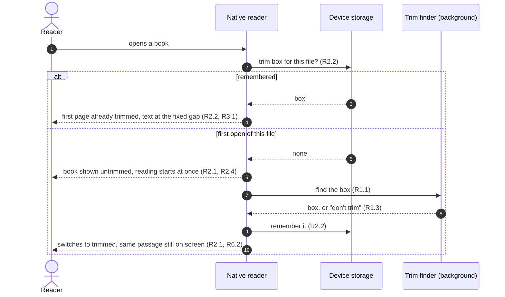
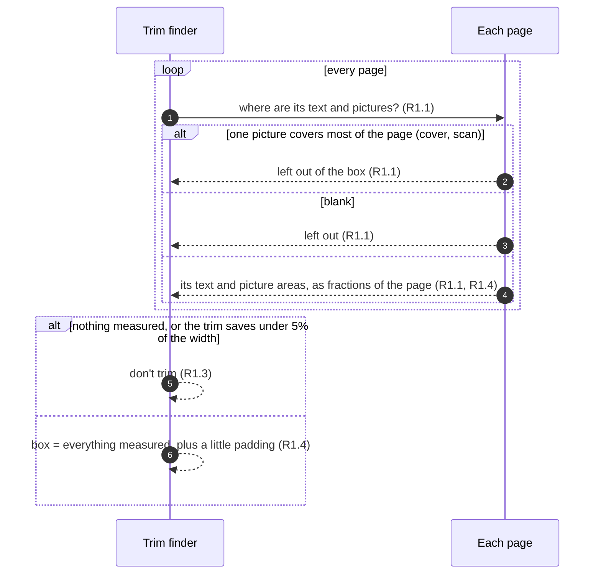

# Reader fit: Requirements

Status: Approved <!-- Draft → Approved -->
Design handoff: none (follows from the page-theme acceptance check on iPad; 14f in docs/handoff/ipad-support/IPAD_AND_HOME_14_16.md is the iPad scroll layout it changes)

## Goal
The space between a book's text and the edge of the page area changes with
the device, the orientation and the reading mode, because the reader scales
the whole PDF page, white margins and all. On an iPad in landscape, Page mode
shows a small column of text in a lot of empty space, while Scroll mode shows
the same page much larger. This trims each book's own white margins (in memory,
never in the file) so the text sits a fixed distance from the page area's edge:
the same in Scroll mode in either orientation, and in Page mode in portrait.

## Out of scope
- Landscape Page mode at the same text width. A page fitted to a landscape
  width is taller than the screen, so it would need scrolling within a page.
  Tried after the device check and dropped: PDFKit's Page mode resets each
  page's zoom on its own, so width-fitted pages came out small, then
  over-zoomed. Deferred past 1.0.0, with its own spec built on a plain
  one-page view. Landscape Page mode shows the whole trimmed page, centred.
- A trim per page. PDFKit uses one zoom for the whole book, so one page left
  wider shrinks every page (checked in the simulator: an untrimmed page took the
  fit, and a trimmed one was drawn at half the width).
- Margins the reader can adjust, and Android (which has no reader yet).

## Flows

Opening a book:

Finding the box:

## Requirements

### R1. One trim box per book
**User story:** As a reader, I want the blank margins gone without losing
anything printed on the page.

**Acceptance criteria**
1. THE reader SHALL work out one trim box per book: the area that holds every
   page's text and pictures, leaving out blank pages and pages where one picture
   covers 70% or more (a cover or a scan).
2. THE reader SHALL NOT change the PDF file or its crop box. Saved comment and
   highlight positions, which are fractions of the crop box and are shared with
   other readers, stay valid.
3. IF no page has text or pictures to measure, or the trim would narrow the
   page by less than 5%, THEN THE reader SHALL show the book untrimmed.
4. THE trim SHALL NOT cut off text or pictures on any page except the
   full-page pictures R1.1 leaves out, which lose their outer edges.

### R2. When the box is worked out
**User story:** As a reader, I want a book to open as fast as it does today.

**Acceptance criteria**
1. WHEN a book file is opened for the first time THE reader SHALL show it
   untrimmed, find the box in the background, and then switch to trimmed.
2. WHEN a book file has been opened before THE reader SHALL use the box
   remembered on the device, so the first page is already trimmed.
3. IF the reader is closed, or another book opened, before the box is found
   THEN the work SHALL stop and nothing SHALL be applied to the wrong book.
4. WHILE the box is being found, scrolling, page turns and the comment sheet
   SHALL respond as they do today.

### R3. The fixed gap
**User story:** As a reader, I want the text the same distance from the edge
whichever way I hold the device and whichever mode I read in.

**Acceptance criteria**
1. WHILE in Scroll mode at the fitted zoom THE gap between the text and the
   page area's left and right edges SHALL be 20pt on iPhone and 40pt on iPad,
   in portrait and landscape.
2. WHILE in Page mode in portrait THE gap SHALL be the same, wherever the
   page's width is what limits it. Where the page's height limits it, the page
   SHALL be centred and the gap SHALL be at least that.
3. WHILE in Page mode in landscape THE whole trimmed page SHALL show, centred.
4. THE reader SHALL keep pinch zoom (from the fitted size up to 3× on iPad) and
   return to the fitted size on rotation, as today.

### R4. One continuous sheet
**User story:** As a reader, I want the trimmed page to look like paper, not a
cut-out.

**Acceptance criteria**
1. THE space between the text and the page area's edge, and between pages in
   Scroll mode, SHALL be the page theme's paper colour, with no page edges or
   shadows inside the page area.
2. THE trim SHALL work in Paper, Sepia and Night, with everything specs/page-theme
   requires still holding (pictures in their own colours, no white in Night).

### R5. Comments and highlights
**User story:** As a reader, I want marks to land on the same words as before
and as for everyone else in my room.

**Acceptance criteria**
1. THE reader SHALL draw comments and highlights on the same words, trimmed or
   not, and as other devices do.
2. WHEN the reader highlights or comments on a trimmed page THE saved position
   SHALL place correctly on an untrimmed page and on other devices.
3. THE gutter dots SHALL sit in the gap beside the text, never over it, on
   iPhone and iPad.

### R6. Keeping the reader's place
**User story:** As a reader, I want trimming never to move me in the book.

**Acceptance criteria**
1. WHEN a book opens THE reader SHALL resume at the saved page, trimmed or not.
2. WHEN the reader switches to trimmed (R2.1) or the device rotates THE passage
   being read SHALL stay on screen.

## Open questions
- [x] The gap is measured from the page area's edge (the rounded card), so a
  gutter dot fits beside the text: 32pt from the screen edge on iPhone, 46pt
  on iPad, the same in every mode and orientation.
- [x] The continuous sheet (R4.1) replaces 14f's separate pages on navy in
  iPad Scroll mode.
- [x] 5% is the smallest trim worth doing (R1.3).
