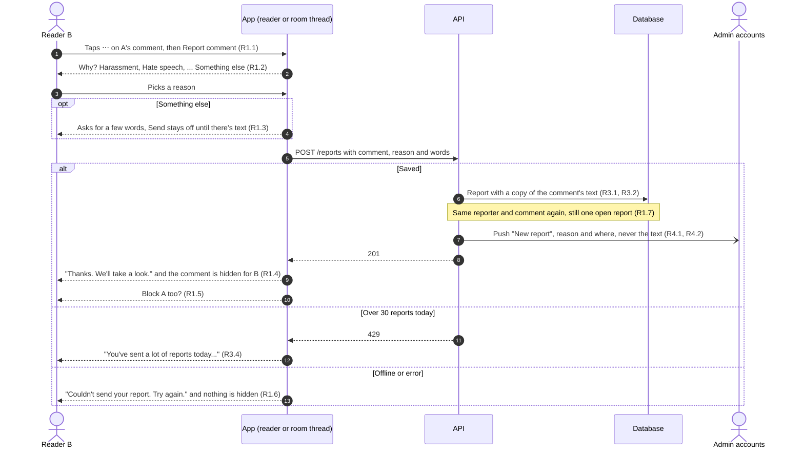
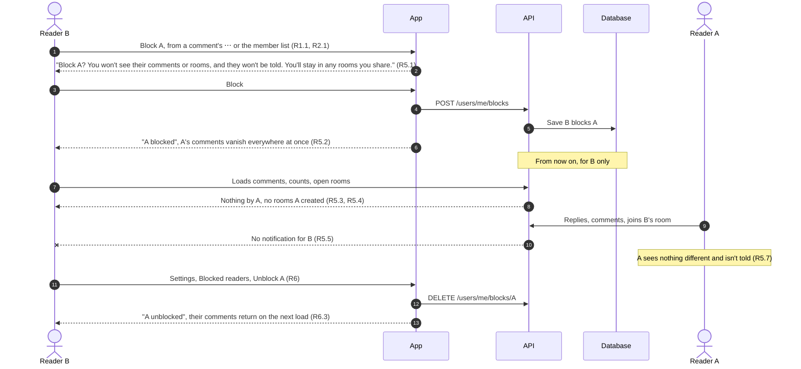
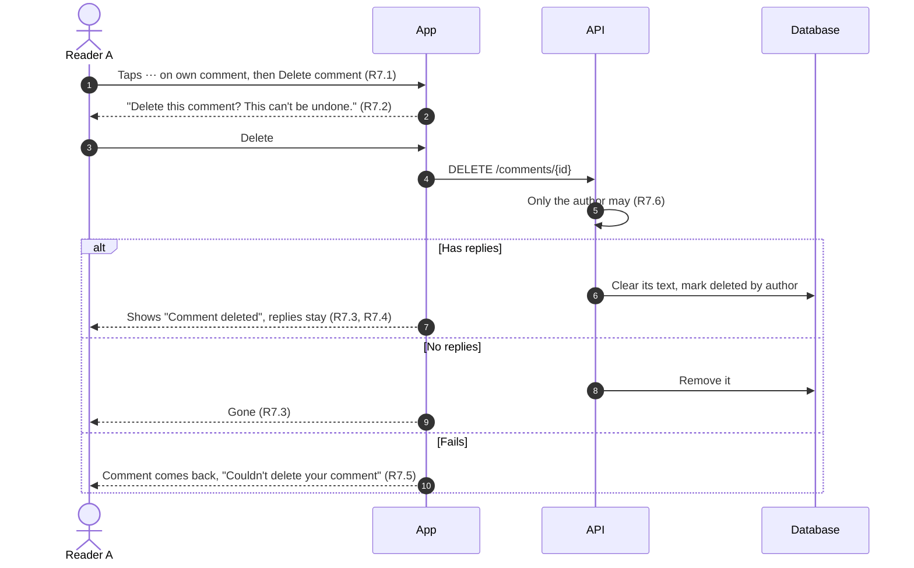
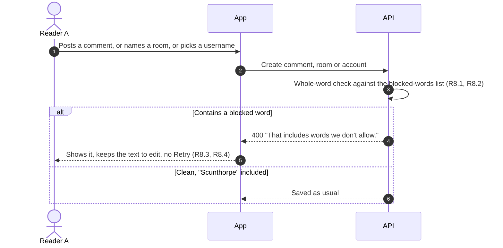

# Report & block: Requirements

Status: Approved <!-- Draft → Approved -->
Design handoff: none. The menus use the system menu and action sheet. The
report sheet and Blocked readers screen follow the Settings sheets and
sub-screens (specs/bug-reporting, NotificationSettingsScreen) and
docs/DESIGN.md.
Spans three places:
- readpanda `packages/api-go` (the API)
- readpanda `packages/portal` (moderation)
- readpanda `site/` (terms and support wording)

Depends on specs/open-rooms, which should merge first: R5.4 changes its
open-rooms list.

## Goal
App Review Guideline 1.2 requires apps where people post content to have:
- a way to filter objectionable material
- a way to report it, with a timely response
- a way to block abusive users
- contact details

ReadPanda has only the last. Readers post comments, name and describe rooms,
and pick usernames. With open rooms (specs/open-rooms), strangers will share
rooms. Today nobody can report, block, or even delete their own comment, and
we have no way to act on a complaint short of editing the database.

This adds:
- reporting comments, readers and rooms
- blocking readers
- deleting your own comments
- a word filter on what gets posted
- push alerts and a Reports page for the admins
- suspending accounts

## Out of scope
- Editing comments
- Automatic hiding after a number of reports. Every report is reviewed by a
  person.
- Machine moderation (AI or image scanning). There are no shared images:
  profile photos stay on the device.
- Muting a reader without blocking them
- Telling a reader they've been reported or blocked
- Appeals inside the app. Suspended readers are pointed to the support
  email.
- Android-specific UI beyond what the shared JS gives

## Flows
The picture first; the numbered requirements below are the exact rules.
Labels like (R1.4) point to them.

### Report a comment
The same flow runs from a member in the member list (report a reader) and
from a room's ⋯ menu or open-room preview (report a room) (R2).



### Block a reader


### Delete your own comment


### Word filter


### Moderation and suspension
```mermaid
sequenceDiagram
    autonumber
    actor Admin
    participant Portal as Admin portal
    participant API
    participant DB as Database
    actor A as Reported reader A
    participant AApp as A's app

    Admin->>Portal: Opens Reports (after the push)
    Portal->>API: GET /admin/reports?status=open
    API-->>Portal: Reports with the stored copy, reason, who and where (R9.1)
    Admin->>Portal: Picks an action
    Portal->>API: POST /admin/reports/{id}/resolve
    alt Remove comment
        API->>DB: Comment shows to everyone as "Removed by ReadPanda" (R9.2)
    else Close or delete room
        API->>DB: Room becomes Invite only, or is deleted (R9.3)
    else Suspend reader
        API->>DB: A is suspended, A's sign-in tokens revoked (R9.4)
    else Dismiss
        API->>DB: No change to the content
    end
    API->>DB: Report and any duplicates closed with the action, who and when (R9.5)
    opt Comment removed, room closed or room deleted
        API-->>AApp: "Your comment was removed" / "Your room is invite-only now" / "Your room was removed", with the reason; a deleted room's other members get "A room was removed" (R9.8)
        AApp->>API: GET /room/{id} for the room on screen
        API-->>AApp: 404, so the room page closes: "This room was removed" (R9.9)
    end
    AApp->>API: Next refresh or post
    API-->>AApp: 403 account suspended (R10.1)
    AApp-->>A: Signed out, "Your account has been suspended. Email ..." (R10.2)
    Admin->>Portal: Later, Reinstate on the Users page (R9.6)
    Portal->>API: PATCH /admin/users/{uuid}
    Note over A: A can sign in again (R10.4)
```

## Requirements

### R1. Report a comment
**User story:** As a reader, I want to report a comment that breaks the
rules, so that someone deals with it.

**Acceptance criteria**
1. EVERY comment by someone else SHALL have a "⋯" menu with "Report
   comment" and "Block <username>". This applies:
   - in the reader's comment sheet
   - in the room page's and Home's comment threads
2. WHEN the reader chooses "Report comment" THE app SHALL ask why, with
   these choices:
   - Harassment or bullying
   - Hate speech
   - Sexual content
   - Violence or threats
   - Self-harm
   - Spam or scam
   - Something else
3. WHEN they choose "Something else" THE app SHALL ask for a few words,
   up to 500 characters, and SHALL NOT send the report until they've
   written something.
4. WHEN a report is sent THE app SHALL show "Thanks. We'll take a look.",
   and SHALL hide that comment from the reporter straight away
   and from then on. If it had replies, it shows as "You reported this
   comment".
5. WHEN a report is sent THE app SHALL offer to block the comment's author.
6. IF sending fails THEN THE app SHALL say "Couldn't send your report. Try
   again." and SHALL NOT hide the comment.
7. WHEN the reader reports the same thing twice THE API SHALL keep one open
   report, not two.

### R2. Report a reader or a room
**User story:** As a reader, I want to report someone's behaviour, or a
room's name or description.

**Acceptance criteria**
1. WHEN the reader taps another member in a room's member list THE app
   SHALL offer "Report <username>" and "Block <username>".
2. A room's page SHALL offer "Report room" in a "⋯" menu to every member
   except its creator. An open room's preview (specs/open-rooms R5) SHALL
   offer it too.
3. Reports of readers and rooms SHALL use the same reasons and "Something
   else" rule as R1.2 and R1.3, and the same thank-you and failure messages
   as R1.4 and R1.6.
4. THE app SHALL NOT offer to report or block yourself, or the "Deleted
   reader" account.

### R3. What a report records
**Acceptance criteria**
1. THE API SHALL store with each report:
   - the reporter
   - what was reported (comment, reader or room) and its owner
   - the room it's in
   - the reason and the reader's words
   - when it was made
2. THE API SHALL store a copy of the reported text: the comment's body, or
   the room's name and description, or the reader's username. Deleting the
   content later SHALL NOT erase the evidence.
3. IF the reporter deletes their account THEN THE report SHALL stay,
   without the reporter.
4. THE API SHALL limit each reader to 30 reports a day, and SHALL answer
   "You've sent a lot of reports today. Email us if it's urgent." beyond
   that.

### R4. Admins hear about reports
**User story:** As the person running ReadPanda, I want to know about every
report quickly, so that I can act on it promptly.

**Acceptance criteria**
1. WHEN a report is made THE API SHALL notify every account with the admin
   role. The push and inbox row read "New report", then "<reason> · <what
   was reported>", for example "Harassment or bullying · comment in AI
   Learning".
2. THE notification SHALL NOT include the reported text itself.
3. IF the push can't be sent THEN THE report SHALL still be saved, and
   SHALL still show in the portal.

### R5. Block a reader
**User story:** As a reader, I want to block someone, so that I don't see
anything from them again.

**Acceptance criteria**
1. WHEN the reader chooses "Block <username>" THE app SHALL ask "Block
   <username>? You won't see their comments or rooms, and they won't be
   told. You'll stay in any rooms you share." with Block and Cancel.
2. WHEN they confirm THE app SHALL show "<username> blocked" and SHALL hide
   that reader's comments everywhere at once: the reader, the room page,
   Home, and comment counts.
3. WHILE someone is blocked THE API SHALL leave their comments out of
   everything it sends the blocker:
   - their replies are left out
   - a thread they started is left out with its replies
   - locked and unread counts leave them out too
4. WHILE someone is blocked THE open-rooms lists (specs/open-rooms R1) SHALL
   leave out rooms they created.
5. WHILE someone is blocked THE blocker SHALL NOT be notified about their
   replies, comments or joins.
6. WHEN both are in the same room THE member list SHALL still show the
   blocked reader, marked "Blocked". Blocking doesn't remove anyone from a
   room.
7. THE blocked reader SHALL NOT be told, and SHALL see nothing different.

### R6. Blocked readers in Settings
**User story:** As a reader, I want to see who I've blocked and undo it.

**Acceptance criteria**
1. Settings → Rooms & privacy SHALL have a "Blocked readers" row, showing
   how many are blocked, that opens a list of them.
2. EACH row SHALL show the username and an "Unblock" button.
3. WHEN the reader taps "Unblock" THE app SHALL remove the block, show
   "<username> unblocked", and SHALL show their comments again from the
   next load.
4. WHEN nobody is blocked THE screen SHALL say "You haven't blocked
   anyone." and explain where to find Block.

### R7. Delete your own comment
**User story:** As a reader, I want to delete something I wrote.

**Acceptance criteria**
1. EVERY comment the reader wrote SHALL have a "⋯" menu with "Delete
   comment".
2. WHEN they choose it THE app SHALL ask "Delete this comment? This can't
   be undone." with Delete and Cancel.
3. WHEN confirmed, IF the comment has no replies THEN THE app SHALL remove
   it, and IF it has replies THEN THE app SHALL show it as "Comment
   deleted" with its replies kept.
4. A deleted comment SHALL have no text, likes, Reply or menu, for anyone.
5. IF deleting fails THEN THE app SHALL put the comment back and SHALL
   show "Couldn't delete your comment".
6. THE API SHALL let only the comment's author delete it this way.

### R8. Word filter
**User story:** As a reader, I don't want slurs and explicit words posted
in the first place.

**Acceptance criteria**
1. THE API SHALL refuse a comment, room name, room description or new
   username that contains a word on its blocked-words list, with "That
   includes words we don't allow."
2. THE match SHALL be on whole words, ignoring case. A blocked word inside
   a longer ordinary word (for example "Scunthorpe") SHALL NOT be refused.
3. WHEN a comment is refused THE app SHALL show the message, SHALL NOT
   offer Retry for it, and SHALL keep the text so the reader can change it.
4. WHEN a room name, description or username is refused THE app SHALL
   show the message by that field, as for its other errors.
5. THE list SHALL live in one file in the API, so words can be added
   without other changes.

### R9. Moderation
**User story:** As an admin, I want to see reports and act on them.

**Acceptance criteria**
1. THE portal SHALL have a Reports page, open reports first, showing for
   each:
   - what was reported, with the stored copy
   - the reason and the reporter's words
   - who reported it and who it's about
   - the room, and when
2. FOR a comment THE admin SHALL be able to remove it. It then shows to
   everyone as "Removed by ReadPanda", keeping replies, as in R7.3.
3. FOR a room THE admin SHALL be able to close it (make it Invite only and
   take it out of open-room lists) or delete it.
4. FOR any report THE admin SHALL be able to suspend the reader it's
   about, or dismiss the report.
5. WHEN an admin acts THE report SHALL record the action, who took it and
   when, and SHALL leave the open list. Other open reports about the same
   content SHALL close with it.
6. THE Users page SHALL show whether each reader is suspended, and SHALL
   let an admin suspend or reinstate them.
7. ONLY admins SHALL be able to use any of this.
8. WHEN an admin removes a comment, closes a room or deletes a room THE API
   SHALL tell the people it affects, in the bell and by push:
   - removing a comment: its author, "Your comment was removed"
   - closing a room: its creator, "Your room is invite-only now"
   - deleting a room: its creator, "Your room was removed", and every other
     member, "A room was removed"
   The author's or creator's message SHALL name the room and the report's
   reason (unless it's "Something else") and give the support email. No
   message SHALL say who reported it or what they wrote. Nothing is sent for
   a comment its author had already deleted.
9. WHEN a room is deleted while a member has its page open THE app SHALL
   take them back to where they came from and show "This room was
   removed". It SHALL check when a moderation notice arrives, when the app
   comes back to the foreground, and when the page loads.

### R10. Suspended accounts
**User story:** As an admin, I want a suspended reader to be unable to post
or keep using the app.

**Acceptance criteria**
1. WHILE an account is suspended THE API SHALL refuse:
   - signing in with any method
   - refreshing its tokens
   - posting comments, creating, joining or changing rooms, reporting,
     and blocking
   - the reads the app refreshes with: the unread count and the reader's
     room list, so the next refresh signs them out
2. WHEN the app is told the account is suspended THE app SHALL sign out and
   SHALL say "Your account has been suspended. Email
   readpanda.support@gmail.com if you think this is a mistake."
3. A suspended reader's existing comments SHALL stay unless an admin
   removes them (R9.2).
4. WHEN an admin reinstates an account THE reader SHALL be able to sign in
   again.

### R11. Wording elsewhere
**Acceptance criteria**
1. THE help screen's "How do I report a comment or a reader?" answer
   (specs/help-support) SHALL explain the in-app options. Email stays as
   the other way.
2. THE site's terms and support page SHALL describe reporting and blocking
   in the app.

### R12. Accessibility
**Acceptance criteria**
1. EVERY "⋯" button SHALL be announced as "More actions for <username>'s
   comment" (or "for this room").
2. THE report reasons, confirmations and Blocked readers rows SHALL work
   with VoiceOver and at larger text sizes.
3. "Comment deleted", "Removed by ReadPanda" and "You reported this
   comment" SHALL be read out as such, not skipped.

## Open questions
- [x] The blocked-words list itself: a short list of slurs and explicit
      sexual terms, kept in the API, reviewed before launch. Agreed
      2026-10-21.
- [x] Spoilers aren't a report reason; the page lock already handles them.
      Not for now (2026-10-21).
- [x] Response time: no promised number of hours anywhere. The app says
      "We'll take a look", and the terms and help say reports are reviewed
      promptly (2026-10-21).
